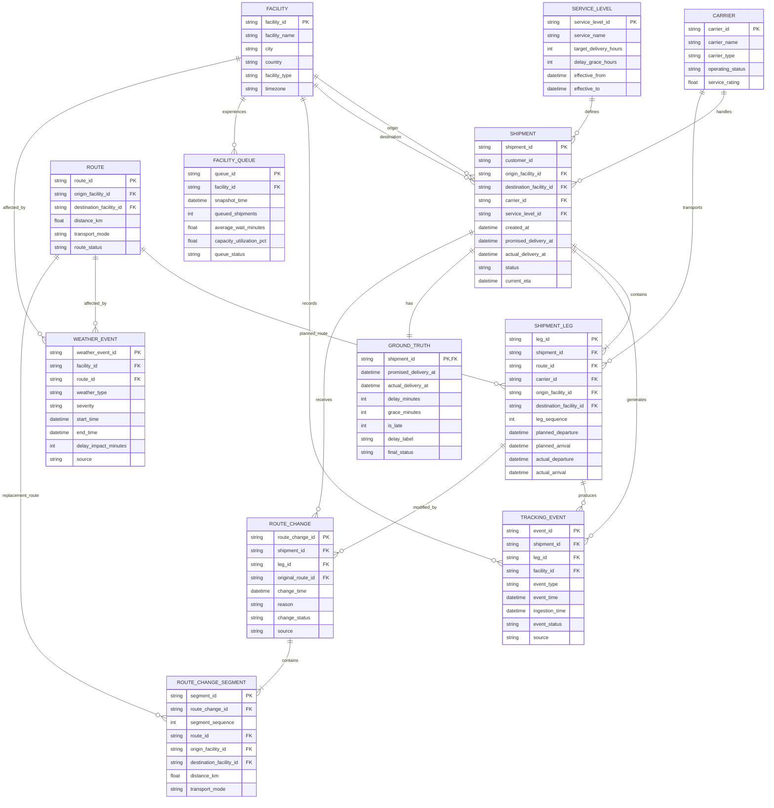

# Logistics ETA Intelligence Platform

## Database Schema

This document describes the logical data model, entities, primary keys, foreign keys, and relationships used by the Logistics ETA Intelligence Platform.

The platform combines shipment information, route plans, carrier tracking events, facility congestion, weather disruptions, service levels, and route changes to estimate shipment delivery times.

## 1. Entity Relationship Diagram

## 2. Primary Keys

Every entity has a unique primary key.

| Entity | Primary Key | Example |
|---|---|---|
| Shipment | shipment_id | SHP-2026-000001 |
| ShipmentLeg | leg_id | LEG-SHP-2026-000001-01 |
| Carrier | carrier_id | CAR-001 |
| Facility | facility_id | FAC-0001 |
| Route | route_id | RTE-2026-000001 |
| TrackingEvent | event_id | EVT-SHP-2026-000001-000001 |
| FacilityQueue | queue_id | Generated unique ID |
| WeatherEvent | weather_event_id | Generated unique ID |
| ServiceLevel | service_level_id | SVC-001 |
| GroundTruth | shipment_id | SHP-2026-000001 |
| RouteChange | route_change_id | RCH-2026-000001 |
| RouteChangeSegment | segment_id | RCH-2026-000001-01 |

## 3. Foreign Key Constraints

- Shipment references Carrier, Facility, and ServiceLevel.
- ShipmentLeg references Shipment, Route, Carrier, and Facility.
- TrackingEvent references Shipment, ShipmentLeg, and Facility.
- FacilityQueue references Facility.
- WeatherEvent references either Route or Facility.
- GroundTruth references Shipment.
- RouteChange references Shipment, ShipmentLeg, and original Route.
- RouteChangeSegment references RouteChange, Route, and Facility.

## 4. Shipment Lifecycle

The shipment lifecycle is represented using status values:

- CREATED
- PICKED_UP
- IN_TRANSIT
- AT_FACILITY
- OUT_FOR_DELIVERY
- DELIVERED
- DELAYED
- CANCELLED

Tracking events provide operational evidence of shipment movement.

A shipment marked DELIVERED or DELAYED must have a corresponding valid delivery event. Cancelled and in-transit shipments must not have a final delivery event.

## 5. Route Change Model

Route changes represent approved modifications to a shipment's original planned route.

Each route change:

1. References the shipment and affected shipment leg.
2. Retains the original route ID.
3. Records an effective change timestamp.
4. References two replacement route segments.
5. Preserves the original leg's starting and ending facilities.

Replacement segments must connect continuously.

The ETA engine applies an approved route change only when:

`change_time <= prediction_time`

This prevents future route information from leaking into historical ETA predictions.

## 6. Temporal Data Rules

The platform maintains separate timestamps for:

- Event occurrence (`event_time`)
- Event ingestion (`ingestion_time`)
- Route change effectiveness (`change_time`)
- ETA prediction (`prediction_time`)
- Facility queue observation (`snapshot_time`)
- Weather disruption validity (`start_time`, `end_time`)

Only records available at the prediction timestamp may influence an ETA estimate.

## 7. Data Integrity Rules

- Primary keys must be unique and non-null.
- Foreign keys must reference existing records.
- Shipment leg sequences must be continuous.
- Consecutive shipment legs must connect.
- Event ingestion must not precede event occurrence.
- Duplicate tracking events must be explicitly identified.
- Weather disruptions must have valid time ranges.
- Facility queue measurements must be non-negative.
- Route changes must preserve original route endpoints.
- Ground-truth labels must remain separate from prediction inputs.

## 8. Dataset Storage

All generated datasets are stored in CSV format under the `data/` directory.

The data generator uses a fixed random seed of `20261022` to support reproducible dataset generation.
